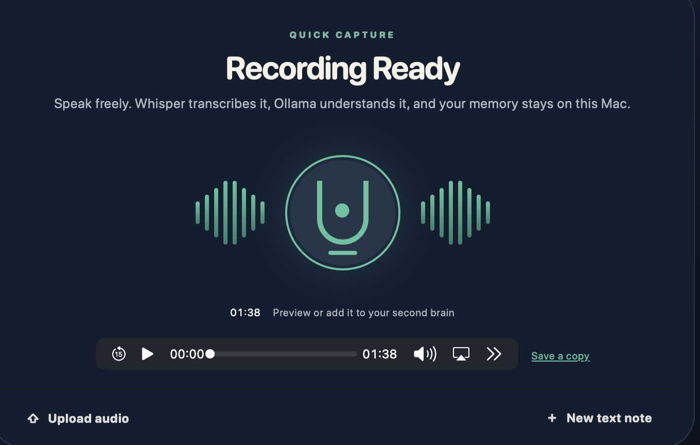
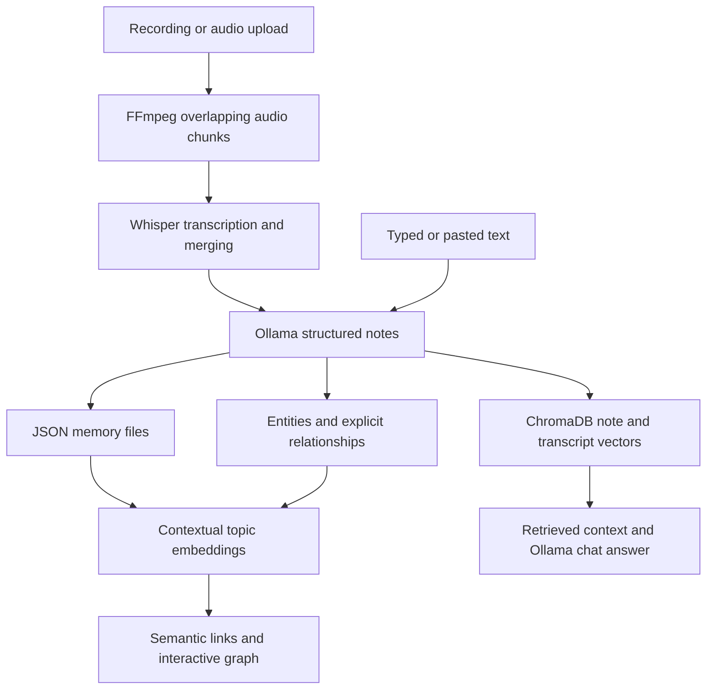

# Echo — Local Voice Notes & Second Brain

A private local second-brain application that records from the browser microphone or accepts uploaded audio, transcribes it with faster-whisper, and turns it into structured notes using Ollama. Completed notes are persisted locally, indexed semantically with ChromaDB, connected in a lightweight knowledge graph, and available to a grounded memory chatbot. It supports Apple `.qta` QuickTime Audio recordings as well as `.m4a`, `.wav`, `.mp3`, `.mp4`, `.webm`, and `.ogg`.



*The capture panel after a recording stops. Use the central microphone to start/stop, Upload audio to choose a recording, and New text note to type or paste a note.*

## Features

| Feature | Purpose |
| --- | --- |
| Browser recording | Capture microphone audio, preview it, and download a copy. |
| Audio upload | Process existing recordings up to 500 MB. |
| Text notes | Type or paste content into the same note-generation pipeline. |
| Structured notes | Generate summaries, key points, decisions, action items, tags, and entities. |
| Calendar journal | Revisit notes by their saved date. |
| Persistent library | Retain transcripts and generated notes across restarts. |
| Memory chatbot | Ask questions across saved notes using local vector retrieval and Ollama. |
| Interactive graph | Explore explicit relationships and estimated semantic similarities between topics. |

## Quick setup

1. Install Python 3.10+, `ffmpeg` (including `ffprobe`), and [Ollama](https://ollama.com/). The project has been run on macOS with Python 3.10.20. Other platforms have not been independently verified.
2. Download or clone this repository and open a terminal in its directory. Create and activate an isolated environment:

   ```bash
   python3 -m venv .venv
   source .venv/bin/activate
   pip install -r requirements.txt
   cp .env.example .env
   ollama pull gemma3:4b
   ```

3. Start the app:

   ```bash
   python -m uvicorn app.main:app --host 127.0.0.1 --port 8000
   ```

4. Open http://127.0.0.1:8000. Keep the terminal running. Press `Ctrl+C` to stop the server.

### Platform installation notes

On macOS with Homebrew, install system prerequisites with:

```bash
brew install python ffmpeg
```

On Debian/Ubuntu:

```bash
sudo apt update
sudo apt install python3 python3-venv python3-pip ffmpeg
```

On Windows, install Python, FFmpeg, and Ollama and ensure their commands are on your PATH. From PowerShell in the project folder:

```powershell
python -m venv .venv
.\.venv\Scripts\Activate.ps1
python -m pip install -r requirements.txt
Copy-Item .env.example .env
ollama pull gemma3:4b
python -m uvicorn app.main:app --host 127.0.0.1 --port 8000
```

If PowerShell blocks activation, use `.\.venv\Scripts\python.exe` directly for Python commands. FFmpeg and Ollama are system applications, separate from the Python virtual environment.

Start the Ollama desktop app before processing notes. If you are not running its desktop service, run `ollama serve` in another terminal. Use `ollama list` to confirm the configured model is installed.

For development, add `--reload` to the Uvicorn command. Reloading backend code interrupts processing jobs, so avoid code changes while audio is processing.

## Using Echo: a guided tour

### 1. Record a thought or conversation


1. Click the **large microphone** in the center of Quick Capture to start recording.
2. Allow microphone access when your browser asks. Speak into your selected microphone.
3. The timer shows elapsed recording time. Click the microphone again to stop.
4. Confirm the prompt to add the recording to your second brain. Processing starts automatically.
5. Use the playback controls to review your recording. Click **Save a copy** to download the audio.

If you decline the processing prompt, download a copy and use Upload audio when you want to process it later. The browser preview is temporary; refreshing or closing the page can discard it.

### 2. Upload audio

Click **Upload audio** at the bottom-left of the capture panel and choose your recording. Selection starts processing immediately.

Supported extensions: `.qta`, `.m4a`, `.wav`, `.mp3`, `.mp4`, `.webm`, `.ogg`. Maximum size: **500 MB**. The file must contain valid media that FFmpeg can decode; renaming an extension does not convert a file.

### 3. Write or paste a text note

Click **New text note** at the bottom-right of the capture panel, or the **+** in the top navigation. Enter an optional title, type or paste your content, then click **Understand & save to memory**.

Ollama generates the structured notes and Echo saves/indexes them. Written notes skip Whisper transcription.

**Direct text-file upload is not implemented.** To import a `.txt` document, open it and paste the contents into New text note. PDF and Word uploads are also not supported.

### 4. Follow processing progress

| Stage | What is happening |
| --- | --- |
| Uploading audio | The browser transfers audio to the local backend. |
| Transcribing audio / chunk N of M | Whisper converts speech to text. |
| Generating notes with Ollama | The model creates structured notes from the transcript. |
| Indexing this note in your second brain | Echo saves the note, embeddings, and extracted graph information. |

The progress bar indicates stages, not a measured percentage or remaining-time estimate. Keep the backend and browser open until processing finishes. First-time model downloads and long recordings can take substantially longer.

### 5. Open saved notes

Completed audio processing opens the saved-memory detail view. Click a card in **Recently edited** to revisit its summary, tags, key points, decisions, action items, and full transcript.

Owners and deadlines are extracted when stated; missing values appear as Not specified. Review generated notes for accuracy.

The current library is ordered by creation date despite the “Recently edited” heading. Editing saved notes is not yet available.

### 6. Search and browse the calendar

Use **Search memories** to filter loaded notes by title, summary, and tags. This is a text filter; semantic search powers the chatbot and graph separately. **View all** expands the visible library.

In **Your memory timeline**, use the arrows to change months and click a marked date to list notes saved that day. Click a listed note to read it. Dates reflect when the memory was saved, not dates mentioned inside the recording.

### 7. Ask your second brain

Type a question in **Ask your second brain**, then click the send arrow. Suggested prompts include Open actions and Recent decisions.

Examples:

- “What decisions did I make about the project?”
- “Which notes discuss Python and AI?”
- “What do my notes say about data retention?”
- “What actions did I assign to myself?”

Echo retrieves relevant note/transcript chunks from ChromaDB and gives them to Ollama as context. Click the source buttons under an answer to open the retrieved memories. These are retrieval references, not independently verified sentence-level citations. The assistant is instructed to acknowledge insufficient context, but can still make mistakes.

### 8. Explore connected topics

Click **Explore graph** inside Ideas that connect. Click a topic, person, project, or memory node to highlight its connections. The inspector shows connected topics and source memories. Click a related-topic button to navigate to it, or a source memory to open the note. Nodes also support keyboard focus and Enter/Space selection.

| Graph element | Meaning |
| --- | --- |
| Solid line | A stored mention or extracted relationship. |
| Dashed amber line | Estimated semantic similarity between topic embeddings. |
| Highlighted node and edges | The selected node and its immediate connections. |
| Cosine score | A similarity measure; it is not the probability that a relationship is true. |

Topic embeddings include labels and context from source-note summaries, so related ideas can connect across separate conversations. For example, Python automation and AI tooling may be related even when discussed on different days. Include context for acronyms so their meaning can be represented usefully.

The graph currently uses a similarity threshold of **0.60**, with at most **three semantic neighbors per topic**. These are defaults in `app/memory.py`, not environment settings. Topic vectors are cached in ChromaDB and refreshed when graph requests detect changed content.

A spring layout pulls stronger matches closer together while repulsion spreads nodes apart. Position is approximate: all links and spacing constraints affect it. Screen distance is not an exact vector-distance measurement. Semantic links are currently used by the graph; chatbot retrieval still uses note/transcript embeddings and explicit graph context.

## Architecture



Long audio is split by **duration**, not compressed file size. Defaults are ten-minute chunks with three seconds of overlap at internal boundaries. FFmpeg produces mono 16 kHz WAV chunks, Whisper transcribes them sequentially, and a word-overlap heuristic merges the results. The heuristic can leave repeated or missing words. Temporary chunks are removed after use.

Whisper currently uses CPU INT8 computation. Audio chunking reduces transcription memory pressure; the merged transcript still goes to Ollama as one input and can exceed a model's context capacity for very long recordings.

## Configuration

Copy `.env.example` to `.env`, edit the values, and restart the backend.

| Variable | Default | Purpose |
| --- | --- | --- |
| `WHISPER_MODEL` | `small` | Transcription model; `base` or `tiny` can reduce resource use. |
| `AUDIO_CHUNK_MINUTES` | `10` | Chunk duration, with a one-minute minimum enforced by the code. |
| `AUDIO_CHUNK_OVERLAP_SECONDS` | `3` | Overlap at chunk boundaries. |
| `OLLAMA_HOST` | `http://localhost:11434` | Ollama service address. |
| `OLLAMA_MODEL` | `gemma3:4b` | Fallback model name. |
| `OLLAMA_FAST_MODEL` | `gemma3:4b` | Preferred model for normal notes and chat. |
| `OLLAMA_SMART_MODEL` | empty | Optional alternate model for API-requested smart chat; no dashboard selector. |
| `KEEP_UPLOADS` | `false` | Set true to retain server-side uploaded audio after processing. |

Install any chosen Ollama model before configuring it. Keep the host local and select a local model for local inference. Remote hosts or cloud-backed models change where content is processed.

## Storage, privacy, and backups

| Location | Stored content |
| --- | --- |
| `data/memories/` | JSON transcripts and structured notes. |
| `data/chroma/` | Note/transcript vectors and cached topic embeddings. |
| `data/memory_graph.json` | Entities and explicit relationships. |
| `uploads/` | Audio inputs and temporary chunks. |
| `.env` | Local configuration. |

No paid API or subscription is required for the default local configuration. Internet access is needed for initial package/model downloads. A Hugging Face download warning relates to fetching a model, not evidence that your recording is being uploaded there.

Back up the whole `data/` directory while the backend is stopped. Uploaded audio is normally removed when processing finishes or fails unless `KEEP_UPLOADS=true`; interrupted or rejected uploads can leave files. Use Save a copy for an audio archive.

Echo is intended for a trusted local machine. It has no authentication or application-level encryption. Keep the server bound to `127.0.0.1`; public hosting requires additional work.

Before publishing, exclude `.env`, `.venv/`, `uploads/`, `data/`, personal recordings, and caches. Review screenshots for personal content. Ignore rules do not remove already committed files from Git history. The included screenshot shows capture controls without saved-note content.

## Troubleshooting

| Problem | Suggested checks |
| --- | --- |
| Failed to fetch / page unavailable | Check that the Uvicorn terminal is running and you are using the correct port. Read backend logs. |
| Ollama connection error | Start Ollama and check `OLLAMA_HOST`. |
| Model not found | Run `ollama list` and install the configured model with `ollama pull`. |
| Slow first run | Allow initial Whisper/embedding downloads to finish. |
| High memory use | Reduce the Whisper model size or chunk duration; Ollama model size also affects RAM use. |
| Missing ffprobe | Check `ffmpeg -version` and `ffprobe -version`; both must be on PATH. |
| Microphone denied | Enable browser and OS microphone permissions for localhost. |
| No speech detected | Check the selected microphone, volume, and whether audio contains speech. |
| Invalid notes JSON | Retry with the default Ollama model and check support for structured output. |
| Empty graph | Save a note with meaningful topics, then reopen the explorer. |
| Unexpected semantic links | Shared labels or note context can produce associations that are not factual relationships. |
| Old interface after update | Refresh the browser; restart the backend after Python changes. |

## Current limitations

- Single-user local application; no accounts, collaboration, or durable job queue.
- No direct text-file, PDF, or Word uploads.
- No speaker diarization or live streaming transcription.
- Jobs/status are held in backend memory and are lost on restart.
- Chat history is held in the page and is lost on refresh.
- No note editing/deletion interface or action-item completion tracking.
- Library loading is capped at 200 notes and the graph at 80 displayed nodes.
- Model-generated notes and relationships require review.
- Dependencies use version ranges, not a fully locked dependency file.

## Project structure

```text
voice-notes-ai/
├── app/
│   ├── main.py             # Routes and background audio processing
│   ├── transcription.py    # Whisper, chunks, transcript merging
│   ├── llm.py              # Ollama structured notes and chat
│   ├── memory.py           # Storage, retrieval, semantic graph
│   └── models.py           # Request/response schemas
├── templates/dashboard.html
├── static/
│   ├── dashboard.js
│   ├── dashboard.css
│   ├── dashboard-theme.css
│   └── dashboard-fixes.css
├── docs/images/            # README screenshots
├── .env.example
├── requirements.txt
└── README.md
```

Older workspace/index frontend files remain in the project. The active home route serves `dashboard.html`.

## API reference

Open **http://127.0.0.1:8000/docs** while the server is running for interactive API documentation.

| Endpoint | Purpose |
| --- | --- |
| `POST /api/process` | Upload multipart audio field `file`; receive a job ID. |
| `GET /api/status/{job_id}` | Read job progress and result. |
| `POST /api/notes` | Create a text note with JSON `title` and `content`. |
| `GET /api/memories` | List saved notes. |
| `GET /api/memories/{memory_id}` | Read a complete memory. |
| `GET /api/graph` | Retrieve explicit and semantic graph connections. |
| `POST /api/chat` | Ask a question grounded in saved memories. |

## Credits and licensing

Built with FastAPI, faster-whisper, FFmpeg, Ollama, ChromaDB, and browser media APIs. Developed iteratively with AI-assisted coding. The initial dashboard layout was inspired by VoiceToNotes and adapted for local memory workflows with a navy/sage theme.

No project license has been selected yet. Add a `LICENSE` file before presenting the repository as licensed open-source software. Dependencies and models retain their respective licenses.

The first transcription downloads the configured Whisper model. The first saved memory also downloads ChromaDB's small local embedding model. Recordings longer than `AUDIO_CHUNK_MINUTES` are converted into overlapping temporary WAV chunks and transcribed sequentially to limit memory use. Change `WHISPER_MODEL`, `AUDIO_CHUNK_MINUTES`, `AUDIO_CHUNK_OVERLAP_SECONDS`, and `OLLAMA_FAST_MODEL` in `.env` as needed. Set `KEEP_UPLOADS=true` only for debugging; uploaded audio and temporary chunks are removed by default. Persistent notes, vectors, and graph data live under `data/`.
